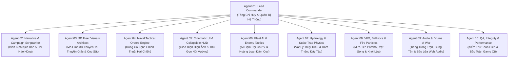

# ĐẶC TẢ CHIẾN DỊCH & KẾ HOẠCH TÁI CẤU TRÚC 10-AGENT
## DỰ ÁN: BẠCH ĐẰNG 938 — HẢI CHIẾN NHẬP VAI CHIẾN THUẬT 3D

> Thực hiện theo chỉ đạo của Người Dùng:
> 1. Chuyển từ điều khiển đi bộ đơn lẻ sang **Hệ thống Ra lệnh Hải chiến Tác chiến 3D** (bắn tên, hỏa tiễn, bè lửa, nhử giặc, phản công) như mô hình sa bàn 3D cũ.
> 2. Tận dụng toàn bộ mô hình 3D có sẵn trong sa bàn (thuyền chiến Đại Việt mũi đồng cờ đỏ, soái hạm Lưu Hoằng Tháo 3 tầng lâu thuyền đầu rồng, bãi cọc sắt ngầm nghiêng, bè lửa hỏa công).
> 3. Thiết kế giao diện điện ảnh, có tính năng **Thu gọn / Mở rộng HUD** để không còn các nút ảo gây vướng tầm nhìn.
> 4. Thành lập **Đội ngũ 10 Agent phối hợp** do Agent 01 làm Tổng Chỉ Huy để tạo ra một game chơi cực hay, kịch tính và hào hùng.

---

## I. CƠ CẤU ĐỘI NGŨ 10 AGENT (THE 10-AGENT TACTICAL TASK FORCE)

### Nhiệm vụ cụ thể của từng Agent:
1. **Agent 01 (Lead Commander / Tổng Chỉ Huy)**: Điều phối toàn bộ luồng công việc, chuẩn hóa hợp đồng giao tiếp giữa các mô-đun, bảo đảm 100% không làm hỏng game 2D/3D cũ của website.
2. **Agent 02 (Kịch Bản & Lời Thoại)**: Xây dựng 5 hồi kịch tính:
   - *Hồi 1 — Xuất Quân Nghinh Địch*: Triều dâng cao, hạm đội Nam Hán vượt cửa biển vào sông.
   - *Hồi 2 — Giả Thua Nhử Giặc*: Chiến thuyền ta vừa đánh vừa lùi, nhử Hoằng Tháo vượt qua bãi cọc ngầm.
   - *Hồi 3 — Con Nước Đổi Dòng*: Triều rút mau chóng, cọc sắt nhọn nhô lên khỏi mặt nước.
   - *Hồi 4 — Hỏa Công & Bão Tên*: Phóng bè lửa, bắn tên lửa thiêu rụi lâu thuyền giặc.
   - *Hồi 5 — Toàn Tuyến Phản Công*: Quân ta khép chặt hai bên bờ, soái hạm địch đâm cọc vỡ nát, đại thắng vang dội.
3. **Agent 03 (Mô Hình 3D Hạm Đội)**: Tái hiện chân thực từ `sa-ban-3d.html`:
   - Thuyền Tiên Phong Đại Việt: Thân thon, mũi bọc đồng, cờ đỏ viền vàng tung bay, hàng mái chèo nhô hai bên mạn.
   - Soái Hạm Lưu Hoằng Tháo: Lâu thuyền đồ sộ 3 tầng, đầu rồng bọc đồng, buồm đen hắc kỳ.
   - Lâu Thuyền Hộ Vệ: Chiến hạm bọc sắt 2 tầng của địch.
   - Bãi cọc sắt ngầm: Thân gỗ mộc cắm nghiêng, bịt sắt nhọn hoắt.
4. **Agent 04 (Lệnh Chiến Thuật Hải Chiến)**: Bổ sung 6 lệnh tác chiến hải chiến trực tiếp:
   - `[🏹 Bắn Loạt Tên]`: Mưa tên đồng loạt vào mục tiêu.
   - `[🔥 Tên Lửa Hỏa Công]`: Đốt cháy cánh buồm và boong tàu địch.
   - `[⚡ Giả Thua Nhử Cọc]`: Duy trì cự ly, dụ địch vào bẫy cọc.
   - `[💥 Phóng Bè Lửa]`: Thả bè lửa lao thẳng vào soái hạm giặc.
   - `[⚔️ Tổng Lực Phản Công]`: Dốc toàn lực tiêu diệt hạm đội địch.
   - `[⚓ Áp Mạn Đổ Bộ]`: Chiếm giữ tàu địch mắc cạn.
5. **Agent 05 (UI Thu Gọn Thông Minh)**:
   - Nút `[◄ Thu gọn HUD]`: Nhấn vào để ẩn toàn bộ nút bấm, đưa màn hình về chế độ ngắm cảnh điện ảnh 3D 100%.
   - Dock lệnh tác chiến: Nằm ngang phía dưới đáy màn hình, biểu tượng trực quan, có đếm ngược thời gian hồi chiêu (Cooldown).
   - Thanh chỉ số chiến dịch: Mực nước triều, Sĩ khí hạm đội, Mục tiêu đang chọn.
6. **Agent 06 (AI Kẻ Địch & Đồng Minh)**:
   - Địch tự động xếp đội hình chữ V truy đuổi khi ta giả thua.
   - Khi triều rút và đâm phải cọc: Tàu địch mất lái, quay cuồng, sĩ khí sụp đổ.
   - Thuyền ta tự động bắn trả tên khi địch lọt vào tầm bắn.
7. **Agent 07 (Thủy Triều & Bẫy Cọc)**:
   - Chu kỳ nước triều thực tế tạo bước ngoặt chiến thuật.
   - Va chạm cọc gây vỡ thân tàu, tạo lỗ thủng nước tràn vào làm chìm tàu địch.
8. **Agent 08 (Hiệu Ứng Hình Ảnh)**:
   - Mũi tên lửa bay theo quỹ đạo parabol có vệt khói lửa rực rỡ.
   - Vệt bọt nước rẽ sóng (wake trails) sau đuôi thuyền.
   - Cột khói đen bốc lên từ tàu địch bị trúng hỏa tiễn.
9. **Agent 09 (Âm Thanh & Trống Trận)**:
   - Tích hợp âm thanh Web Audio procedural: Nhịp trống đồng thúc giục, tiếng rít của tên bay, tiếng gãy vỡ của gỗ khi đâm cọc.
10. **Agent 10 (Kiểm Thử & Đảm Bảo Toàn Vẹn)**:
   - Kiểm tra 197/197 test case và đảm bảo 100% các trang `sa-ban.html`, `sa-ban-3d.html` và `trang-chinh.html` không bị lỗi.

