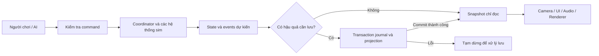

# Hợp đồng giao tiếp và trạng thái — v0.2

**Đặc tả triển khai tương lai, chưa phải API đã tồn tại.** Thuật ngữ/schema ở đây ưu tiên hơn tên gợi ý trong sơ đồ thư mục. Một writer điều khiển một slot; core là hàm chuyển trạng thái theo tick, không phụ thuộc UI/render/backend.

## 1. Các miền trạng thái

```text
GameSession
  sessionId, lifecycle, pauseReasons, loadGeneration, authGeneration
  accountScope: {kind: guest|firebase, principalId, authStatus}
  writer: {slotId, leaseEpoch, leaseOwner, leaseExpiresAt}
  versions: {schemaVersion, simVersion, configVersion, contentVersion}
  configHash, contentHash
  campaign: CampaignState                     # projection từ journal đã commit
  world: WorldState                           # bản committed + bản tick đang tính
  view: ViewState                             # không dùng làm save gameplay
```

| Miền | Thành phần | Chủ sở hữu, khả năng lưu |
|---|---|---|
| `CampaignState` | campaignId, selectedHeroId, chapterInstanceId, attemptId, roster, ship registry, inventory accounts, consequences, reward claims, campaign time, revision/seq | Campaign reducer; chỉ sửa qua journal transaction; luôn lưu. |
| `WorldState` | tick, rng streams, chapter phase/deadlines, entities/poses/velocities, attachments, projectiles, fire/leaks, jobs, AI orders/path queues, fog/intel, controlOwner, objective facts | Coordinator; checkpoint + command log + consequence journal; không chứa DOM/Three objects. |
| `ViewState` | camera yaw/zoom/mode, map open, HUD selection, menu/focus, animation interpolation, effects, quality | Presentation; có thể bỏ và dựng lại. Camera/quality preference lưu thiết bị riêng. |
| `AccountScope` | UID thật hoặc guest-install ID; auth pending/ready/signedOut/error | Auth adapter; core không gọi SDK. Session không đổi principal trong khi chạy. |

`roster` lưu stable ID, tên hiển thị, kind (`mainHero`, `reserveOfficer`, `soldier`), role, squad/commander, equipment IDs, health/wounds, service state (`available`, `deployed`, `downed`, `wounded`, `missing`, `captured`, `dead`), XP và lịch sử. Tên có thể trùng nhưng ID không trùng. Nhân vật chính không có nhánh dead; soldiers/reserves có. Một ID chỉ thuộc một squad/boat/cargo attachment tại một thời điểm.

`shipRegistry` có persistent shipId, archetype, crew capacity, component integrities, flooded mass, destroyed/captured state, cargo accounts. Mesh pooled được tái dùng nhưng không tái dùng entity ID đã chết. Trạng thái mất vĩnh viễn không chỉ lưu trong mesh hoặc danh sách render.

## 2. Command envelope



Sơ đồ chỉ ranh giới ghi dữ liệu; thứ tự từng hệ sim và replay tail được định nghĩa trong kiến trúc/lưu, không được bỏ qua vì mũi tên rút gọn.

```text
Command {
  id: sessionId + ':' + inputSequence,
  sessionId, attemptId, expectedControlEpoch,
  tick: integer, sequence: integer,
  issuer: {kind: player|ai|script, actorId},
  type, payload
}
CommandReceipt = accepted{commandId, scheduledTick}
               | rejected{commandId, code, detailKey}
```

Input adapter chuẩn hóa pointer/keyboard thành command ở tick kế tiếp; giữ phím là intent cập nhật, không tự spawn event mỗi DOM repeat. AI dùng cùng validator. Chỉ scene đang focus nhận input, bỏ qua input/textarea/select/contenteditable; touch pointer dùng bounding rect và canvas pixel ratio. Pointercancel/blur/pause/thoát xóa held intents. `preventDefault` chỉ ở vùng điều khiển cần thiết.

| Command | Payload chủ yếu | Kiểm tra bắt buộc |
|---|---|---|
| `MoveIntent` | actorId, forward/turn/strafe chuẩn hóa | Actor đang điều khiển, attachment phù hợp, không wounded; sequence mới nhất. |
| `AimFire` | actorId, weaponId, aimRay hoặc knownTargetId | Range/LOS ở sim, ammo/stamina, action phase; không cho client gửi số damage. |
| `Melee`, `Parry` | actorId, aimDirection | Windup/recovery/stamina, controlEpoch. |
| `Board`, `Disembark` | actorId, boatId, anchorId | Gap, relative speed, chỗ đứng, stamina; anchor không hợp lệ thì reject, không teleport. |
| `IssueOrder` | commanderId, squadId, objective/position, stance, lossThreshold | Quyền chỉ huy, thông tin biết được, threshold hợp lệ, command delay; không đọc địch trong fog. |
| `Work` | actor/squad, jobKind, target, resourceAccount | Worker, reach, supplies, unique jobId; đủ vật tư mới reserve, cancel hoàn phần chưa consume. |
| `RequestRetreat` | chapterInstanceId, rallyPointId | Đang RUNNING, điểm rút hợp lệ; đặt objective rút, không teleport cả quân về. |

Pause/map/settings là **app intent**, không combat command. `SetMapOpen` đổi UI và phát lệnh handoff control tại ranh giới tick; `SetPaused` chặn tick sau batch hiện hành. Duplicate commandId trả receipt cũ; command sai session/attempt/control epoch, stale tick, nonfinite hoặc ngoài giới hạn trả reject. Không “thử lại” command gây tiêu hao bằng ID mới nếu chưa biết receipt cũ.

## 3. Sự kiện, thứ tự và side effect

```text
DomainEvent {
  eventId: campaignId + ':' + attemptId + ':' + tick + ':' + ordinal,
  schemaVersion, tick, sequence, type, subjectIds, causeId,
  payload, consequenceKey?       # khóa nghiệp vụ bền vững, không chỉ UUID
}
CommitReceipt { revision, committedSeq, committedTick, batchId, checksum }
```

- Producer hệ thống tạo intents, coordinator sort/resolve thành events. Chỉ reducer của miền sở hữu được áp dụng; UI/audio nhận bản read-only sau commit với các hậu quả cần bền vững.
- `DeathRecorded(soldierId)` có consequenceKey `death:<soldierId>`; `RewardClaimed` dùng `reward:<chapterInstanceId>:<objectiveId>`; `SupplyTransferred` có transferId; `ChapterResolved` có `resolve:<chapterInstanceId>:<attemptId>`. Retry callback không tạo consequence key mới.
- Ví dụ: `AimFire` → validator → reserve/consume ammo + projectile spawn trong cùng batch → commit → `ShotFired` cho audio/render → swept hit → `DamageApplied` → `HeroWounded`/`SoldierDowned` → bleed/cứu → `DeathRecorded` nếu cần. Không emit Death từ cả collision lẫn animation callback.
- `BoatImpaled` mang stakeId/contactEpisodeId và component delta; hull cháy/rò là tick work tiếp theo, không gọi lại impact damage.
- Event đồng thời: resolve contact/hit theo tick, tính health aggregate rồi phân loại gục; mainHero ưu tiên protected-wound path. Hệ thống objective nhận state cuối tick, tránh vừa thắng vừa thua vì callback khác thứ tự.
- Presentation events có thể drop/coalesce (bọt nước, tia lửa) theo quality; domain events, projectile thật và thương vong không được drop. UI badge chỉ cập nhật khi giá trị thay đổi, rate cap trong config.

## 4. API module dự kiến

```text
createSession({root, config, content, repository, auth, renderer, audio, clock}) -> Session
Session.load({slotId, mode: new|resume|retry}) -> Promise<LoadResult>
Session.start() -> Promise<Started|Error>     # idempotent theo generation
Session.dispatch(command) -> CommandReceipt
Session.pause(reason) / resume(reason)       # resume chỉ bỏ reason của caller
Session.getView() -> Readonly<ViewSnapshot>
Session.exit({destination}) -> Promise<ExitResult>
Session.dispose() -> void                   # gọi nhiều lần vẫn an toàn

Simulation.step({state, commands, config, tick}) -> {nextState, events, durablePatch}
Renderer.render({previous, current, alpha, view, quality}) -> RenderStats
Renderer.resize({cssWidth, cssHeight, dpr, safeInsets})
Renderer.dispose()
Audio.consume({events, consent, lifecycle, narrationState})
Repository.open({scope, slotId, versions}) -> Promise<SaveHandle>
Repository.commit({expectedRevision, leaseEpoch, batchId, events, projection, resumeTail})
  -> Promise<CommitReceipt|SaveError>
Repository.checkpoint({revision, worldSnapshot, rngStates, hashes})
Repository.loadLatest() -> Promise<ValidatedSave|SaveError>
Repository.exportCommitted() -> Promise<Blob>
Repository.close()
```

Không đưa Promise/await/network vào `Simulation.step`. App tính candidate tick, persistence xử lý ở ranh giới, rồi coordinator mới publish; chi tiết commit barrier ở [save-and-recovery.md](save-and-recovery.md). Renderer chỉ đọc snapshot; không raycast Mesh rồi trừ HP trực tiếp. Picking trả entityId/ground point, command validator vẫn kiểm tra tồn tại/quyền/tầm nhìn.

## 5. AI và điều khiển nhân vật

- Cấp chiến dịch giao mục tiêu cho 3 chỉ huy AI → tổ trưởng → binh sĩ. Utility selector chọn giữ/áp sát/bắn/né/cứu/rút; FSM thực hiện hành động. Không gọi API AI hoặc có máy chủ sim.
- Mỗi AI có perception riêng/theo mạng thông tin của đơn vị. Enemy và friendly áp dụng cùng contact/weapon rules; difficulty sau này không được “biết” vị trí bị che nếu chưa đặc tả.
- Sensing theo spatial grid, LOS chỉ cho ứng viên gần; path graph gồm bờ, bến, boong và cửa chuyển attachment. Path request queue có budget; chờ đường thì giữ/tự vệ, không teleport. Grid/navigation theo nhóm giảm CPU nhưng identity, health và hits vẫn từng người.
- Tổ trưởng nhận mục tiêu, ngưỡng tổn thất, stance và chính sách tự rút. Khi đứt liên lạc, thực hiện lệnh cuối và ghi tuổi thông tin; không nhận lệnh tức thì xuyên fog.
- `controlOwner={actorId, epoch, vesselHelmsmanId?}` là duy nhất. Khi gục, tăng epoch, hủy lệnh cũ, chọn reserve available theo roster priority ổn định; không đổi actor dựa vào mesh gần camera.
- Chi tiết bị thương/tiếp quản/hồi phục trong [đặc tả lưu](save-and-recovery.md), áp dụng cả mainHero AI và nhân vật trung tâm.

## 6. Lỗi và hợp đồng phục hồi

| Mã | Phản ứng |
|---|---|
| `ASSET_MISSING`, `ASSET_HASH_MISMATCH` | LOAD lỗi rõ assetId, thử lại/hủy; asset mỹ thuật tùy chọn có placeholder đã khai báo, collision asset bắt buộc không được bỏ. |
| `SAVE_VERSION_NEWER`, `SAVE_CORRUPT` | Không ghi đè. Cho xuất file, chọn bản backup hợp lệ hoặc quay menu; migration copy-on-write. |
| `SAVE_QUOTA`, `SAVE_IO_TIMEOUT` | Pause với saveFailure, giữ batch chưa commit, retry đúng batchId; không tiếp tục tích lũy tổn thất chưa lưu. |
| `WRITER_CONFLICT` | Tab thứ hai read-only; writer bị mất lease dừng trước commit kế, không last-write-wins. |
| `AUTH_CHANGED`, `CLOUD_CONFLICT` | Tách scope, dừng sync cũ; giữ bản cục bộ và báo xung đột; không merge bằng timestamp. |
| `WEBGL_LOST` | Auto-pause, lưu core nếu an toàn; dựng renderer mới sau restore, chỉ resume theo người chơi. |
| `COMMAND_REJECTED` | Phản hồi nhẹ ở UI, không trừ vật tư, không phát animation bắn đã thành công. |

## 7. Kiểm tra hợp đồng phải viết trước tích hợp gameplay

| ID | Fixture/tiêu chí |
|---|---|
| C01 | Cùng seed/config/commands → cùng checksum hậu quả và cùng kết quả; đổi render preset không đổi sim. |
| C02 | Submit một commandId hai lần chỉ có một ammo debit/projectile. |
| C03 | Damage đồng thời làm gục hero: không death event, chỉ một takeover; actor epoch cũ bị reject. |
| C04 | Pause 30 giây giờ thực: tick/triều/đạn/cứu thương không đổi; mở map 30 giây: đều tiến. |
| C05 | Đang lái mở map: giữ hướng/ga và tự vệ; rời thuyền: phó tướng giữ station; lệnh không nhân đôi. |
| C06 | Friendly fire/đạn nhanh/boong di động/rơi nước: không tunnel, không hit lặp theo frame. |
| C07 | Fog: targetId khuất chỉ có lastSeen, AI không dùng live pose; hết tuổi tin thì chuyển unknown. |
| C08 | Thiếu asset/abort LOAD/thoát rồi callback trễ: generation cũ không mở scene/audio. |
| C09 | Dừng/mở 10 lần: một loop khi chơi, không loop/listener/voice còn sống sau dispose. |
| C10 | Touch ở 320/360/375/390/430px và desktop: ray đúng điểm, nút ≥44px, input text không bị phím game chặn. |

Các fixture trên **chưa chạy** ở chặng thiết kế. Mỗi test sau này lưu configHash, seed, runtime/device, commands, observed events, checksums và ảnh khi cần.
